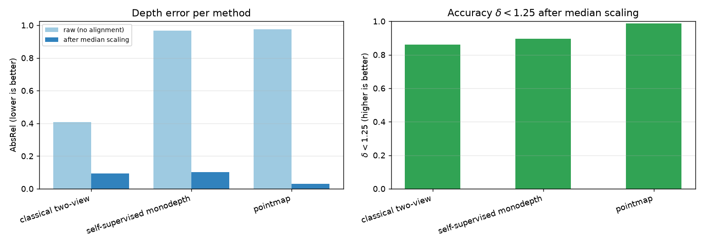
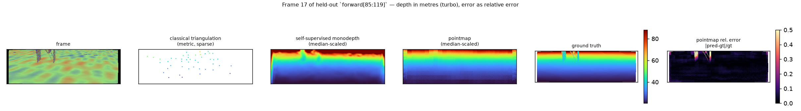
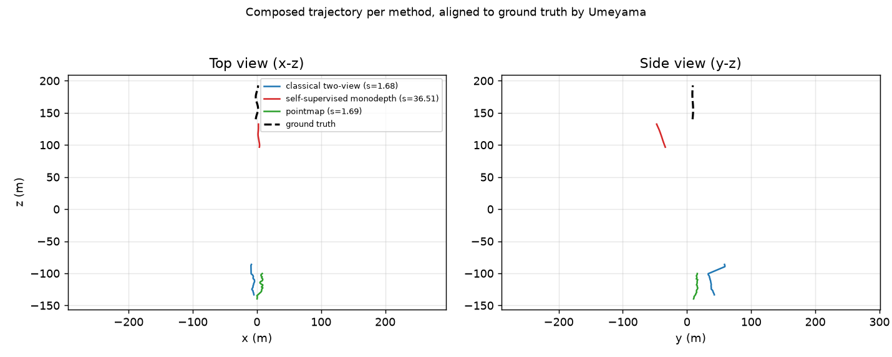
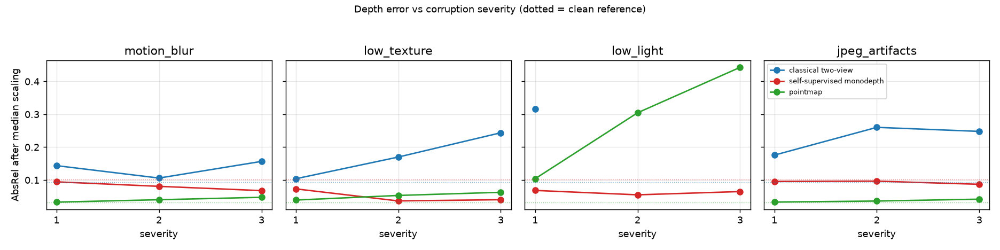
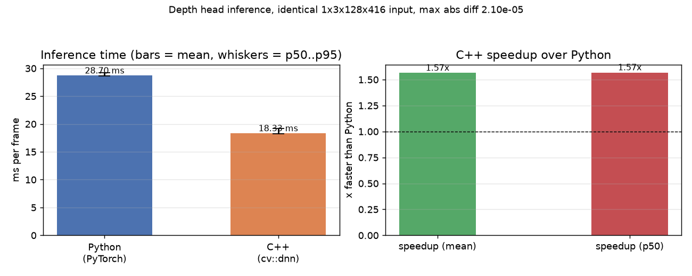

# MonoGeoFlightLog

Monocular geometry for aerial / driving flight logs: classical camera physics next to
learned geometry, with an explicit scale-alignment analysis and a C++17 deployment path.



## 1. What it does

MonoGeoFlightLog takes a monocular video log — a drone flight, a dashcam drive — and runs
three *families* of two-view geometry on exactly the same frames, at the same resolution,
with the same metrics: **classical projective geometry** (checkerboard calibration, SIFT
matching, essential matrix, pose recovery, triangulation, reprojection error), a
**self-supervised depth + ego-motion network** trained only through a photometric loss
through a differentiable camera model, and an **end-to-end two-view pointmap regressor** in
the style of DUSt3R/MASt3R that emits per-pixel 3D pointmaps plus a confidence map. Every
method is then scored for depth accuracy (AbsRel, SqRel, RMSE, RMSE-log, δ<1.25), pose
accuracy (rotation, translation direction, ATE, RPE), focal-length recovery and runtime,
before and after median/Umeyama scale alignment; stressed under motion blur, low texture,
low light, JPEG artifacts and altitude/viewpoint domain shift; and finally the depth head is
exported to ONNX and executed from a C++17 program that is checked for bit-level parity
against PyTorch and timed. The whole repository runs offline on CPU in minutes thanks to a
deterministic synthetic flight-log renderer, which exists so that ground-truth depth *and*
pose are exact — everything learned here is trained and scored against known geometry, with
no hand-written numbers anywhere in `results/`.

## 2. Architecture

```
                    ┌───────────────────────────────────────────────────────────┐
                    │ monogeo.synth  —  deterministic flight-log renderer        │
                    │  analytic fractal terrain (height+colour = f(x,z))         │
                    │  per-frame terrain raycast -> hole-free GT depth           │
                    │  lexsort z-buffer -> correct occlusion                     │
                    │  pinhole x = K[R|t]X  +  OpenCV radial-tangential distortion│
                    └───────────────┬───────────────────────────┬───────────────┘
                                    │                           │
                    ┌───────────────▼──────────┐   ┌────────────▼───────────────┐
                    │ monogeo.data             │   │ monogeo.synth checkerboard │
                    │ Sequence / SequenceDataset│   │ (known geometry)          │
                    │ kitti:/euroc: loaders     │   └────────────┬──────────────┘
                    │ synthetic fallback       │                │
                    └───┬──────────────┬───────┘      ┌─────────▼─────────┐
                        │              │              │ monogeo.calib     │
        ┌───────────────▼───┐   ┌──────▼─────────┐    │ findChessboard +  │
        │ monogeo.twoview   │   │ models/        │    │ calibrateCamera   │
        │ SIFT -> E -> R,t  │   │  depth_net     │    │ -> K, dist, RMS   │
        │ triangulate       │   │  pose_net      │    └───────────────────┘
        │ reprojection err  │   │  pointmap_net  │
        │ scale_from_gt     │   └──────┬─────────┘
        └─────────┬─────────┘          │
                  │            ┌───────▼──────────────────────────────┐
                  │            │ monogeo.geometry                     │
                  │            │  BackprojectDepth  K^-1, pixels->3D  │
                  │            │  Project3D         K, pose, 3D->pixel│
                  │            │  (differentiable, gradients flow into│
                  │            │   both depth and ego-motion)         │
                  │            └───────┬──────────────────────────────┘
                  │                    │
                  │            ┌───────▼──────────────┐
                  │            │ monogeo.losses       │
                  │            │  0.85*SSIM + 0.15*L1 │
                  │            │  min over sources    │
                  │            │  auto-mask           │
                  │            │  edge-aware smooth   │
                  │            └───────┬──────────────┘
                  │                    │
                  │       ┌────────────▼─────────────┐   ┌──────────────────────────┐
                  │       │ train_depth / train_     │   │ monogeo.pointmap_ops     │
                  │       │ pointmap (seeded, CPU)   │   │  weighted_umeyama        │
                  │       └────────────┬─────────────┘   │  pose_from_pointmaps(PnP)│
                  │                    │                 │  focal_from_pointmaps    │
                  │                    │                 │  scale consistency       │
                  │                    │                 └────────────┬─────────────┘
                  └────────┬───────────┴──────────────────────────────┘
                           │
              ┌────────────▼─────────────┐   ┌────────────────────────────────────┐
              │ monogeo.compare          │   │ monogeo.metrics                    │
              │  3 methods, same frames  │   │  AbsRel SqRel RMSE RMSElog δ<1.25^k│
              │  scale_analysis block    │   │  ATE / RPE after Umeyama           │
              └────────────┬─────────────┘   └──────────────┬─────────────────────┘
                           │                                │
        ┌──────────────────▼────────────────────────────────▼─────────────┐
        │ monogeo.corruptions  ->  monogeo.evaluate (evaluate | stress)    │
        │ motion blur / low texture / low light / jpeg + domain shift      │
        └───────────────────────────────┬─────────────────────────────────┘
                                        │
                     ┌──────────────────▼──────────────────┐
                     │ scripts/make_plots.py  -> figures   │
                     │ monogeo.report        -> RESULTS.md │
                     └──────────────────┬──────────────────┘
                                        │
              ┌─────────────────────────▼────────────────────────────┐
              │ monogeo.export -> artifacts/depth_net.onnx           │
              │ cpp/depth_infer (C++17, cv::dnn) -> parity + timings │
              └──────────────────────────────────────────────────────┘
```

### File map

| Path | What is in it |
|---|---|
| `src/monogeo/synth.py` | Analytic terrain, per-frame raycast renderer, trajectories, checkerboard |
| `src/monogeo/data.py` | `Sequence`, `SequenceDataset`, held-out `splits`, KITTI/EuRoC loaders, synthetic fallback |
| `src/monogeo/calib.py` | `calibrate_from_checkerboards`, `calibration_report`, distortion-field metric |
| `src/monogeo/twoview.py` | `match_features`, `estimate_pose`, `triangulate`, `reprojection_error`, `scale_from_gt`, `pose_error` |
| `src/monogeo/geometry.py` | `BackprojectDepth`, `Project3D` — the differentiable camera model |
| `src/monogeo/losses.py` | SSIM, photometric error, min-over-sources, auto-mask, disparity smoothness |
| `src/monogeo/models/depth_net.py` | ResNet-18 encoder + multi-scale disparity decoder, `disp_to_depth` |
| `src/monogeo/models/pose_net.py` | Shared-encoder pose regressor, `pose_vec_to_mat` (Rodrigues) |
| `src/monogeo/models/pointmap_net.py` | Patchify → ViT encoder → cross-attention decoder → pointmap + confidence head |
| `src/monogeo/pointmap_ops.py` | Umeyama, median scale, PnP pose from pointmaps, focal recovery |
| `src/monogeo/train_depth.py`, `train_pointmap.py` | Seeded CPU training loops with CSV logs |
| `src/monogeo/metrics.py` | Depth metrics, ATE, RPE, trajectory alignment |
| `src/monogeo/compare.py` | Three-way comparison + `scale_analysis` |
| `src/monogeo/corruptions.py` | Motion blur, low texture, low light, JPEG at 3 severities |
| `src/monogeo/evaluate.py` | `monogeo evaluate` and `monogeo stress` |
| `src/monogeo/export.py` | ONNX export, reference tensors, Python timing |
| `src/monogeo/report.py` | `results/RESULTS.md` from the JSON files |
| `src/monogeo/cli.py` | The `monogeo` command line |
| `cpp/` | C++17 inference (`cv::dnn`, optional LibTorch), CTest parity test |
| `scripts/` | `reproduce.sh`, `make_plots.py`, `bench_cpp_vs_python.py`, `fetch_data.py` |

### The camera model, and why depth is only recoverable up to scale

The classical pipeline uses the pinhole model directly: a point `X` in the world maps to
`x = K [R|t] X`, and `monogeo.synth` renders by *forward* projecting a 3D point cloud through
exactly that expression, then applying the same radial-tangential distortion that
`cv2.undistort` inverts. `tests/test_synth.py` re-implements the projection independently and
asserts it agrees with the renderer to better than 1e-6 px, which means the ground truth the
learned models train on is not a self-fulfilling prophecy.

The learned pipeline trains *through* the same model. `BackprojectDepth` turns a predicted
depth map into camera-frame points with `K⁻¹`; `Project3D` applies a relative pose and `K` and
returns `grid_sample` coordinates. Both are plain tensor ops, so a photometric loss on a
warped image back-propagates into the disparity head *and* the pose head simultaneously —
there is no finite-difference or lookup approximation anywhere.

Monocular depth is recoverable only up to scale, and this repository makes that concrete
rather than apologetic. From a single calibrated camera, `X` and `λX` produce identical
images for `λ > 0`; the essential matrix therefore only determines the direction of `t`, and
a pointmap is only defined up to a per-scene factor. Everything downstream reacts to that:

* the classical baseline triangulates with a **unit baseline** and reports the factor it
  would need (`scale_from_gt`);
* the self-supervised net is trained with a scaled translation, so it settles on the
  self-consistent pair (`depth`, `t`) that is ~33x too small;
* the pointmap model is trained on pointmaps divided by a per-sample norm;
* every metric is reported **raw**, **median-scaled** and **Umeyama-aligned**.

The photometric loss is Monodepth2's, written out explicitly: `0.85·(1−SSIM)/2 + 0.15·|Δ|`
per pixel, a per-pixel minimum over the two source frames so an occluded pixel only has to be
explained by one neighbour, an auto-mask that discards pixels the *unwarped* source already
explains (which is what stops the ego-motion collapsing to zero), and an edge-aware,
mean-normalised disparity smoothness prior.

## 3. How to run

```bash
# install (Python 3.11)
python3.11 -m venv .venv && source .venv/bin/activate
pip install -e ".[dev]"

# everything, end to end, teed to results/run_log.txt  (~25 min on 4 CPU threads)
bash scripts/reproduce.sh              # SKIP_CPP=1 to skip ONNX + CMake

# or one stage at a time
monogeo calibrate     --out results/calibration.json
monogeo two-view      --sequence forward --out results/two_view_baseline.json
monogeo train-depth   --config configs/default.yaml
monogeo train-pointmap --config configs/default.yaml
monogeo compare       --out results/method_comparison.json
monogeo evaluate      --out results/metrics.json
monogeo stress        --out results/stress_tests.json
python scripts/make_plots.py --results results
monogeo report        --out results/RESULTS.md

# C++17 inference: export, build, test, benchmark
monogeo export --out artifacts/depth_net.onnx
# CMake needs the *C++* OpenCV development files (the pip wheel only ships Python
# bindings). On Linux: sudo apt install libopencv-dev cmake.
# On macOS, a project-local conda env is the least intrusive way to get them:
#   conda create -y -p .cv -c conda-forge opencv
cmake -S cpp -B cpp/build -DCMAKE_BUILD_TYPE=Release \
      -DOpenCV_DIR="$(pwd)/.cv/lib/cmake/opencv4"
cmake --build cpp/build -j
ctest --test-dir cpp/build --output-on-failure
python scripts/bench_cpp_vs_python.py
```

`make help` lists all of the above as Make targets (`install`, `test`, `run`, `cpp`, `clean`, …).

### Pointing it at real data

The synthetic renderer is the default and the fallback; real data is opt-in and never
required. Download once (browser step for both datasets, see
`python scripts/fetch_data.py --dataset kitti_odom|euroc` for the exact layout), then:

```bash
# KITTI odometry: data/kitti_odom/sequences/00/{image_0,calib.txt,poses.txt,velodyne_points}
monogeo evaluate --sequence kitti:00
# EuRoC MAV cam0: data/euroc/MH_01_easy/mav0/cam0/{data,sensor.yaml}
monogeo evaluate --sequence euroc:MH_01_easy
```

`monogeo.data.load_sequence` prints which source it used, and falls back to the synthetic
renderer with an explanatory message if the files are missing. A UAV video would be wired in
by adding a loader that fills the same `Sequence` fields (frames, depth if available, poses if
available, `K`, distortion); anything missing is simply reported as `0`/unknown and excluded
from the metrics by the validity masks.

## 4. Data

**Every number in this README, and every file in `results/`, was produced by the
deterministic synthetic renderer.** No KITTI or EuRoC data was present in this build; the
loaders and `scripts/fetch_data.py` are implemented and tested for their error paths, but
they were not exercised on the real datasets. `results/*.json` records `"data_source":
"synthetic"`.

| | |
|---|---|
| Source | `monogeo.synth`, scene seed 0 |
| Resolution | **128 × 416** (h × w) for every method, every metric, every figure |
| Camera | 62° horizontal FOV, `fx = fy = 346.17 px` at 416 px wide, image-centre principal point |
| Distortion | `[k1,k2,p1,p2,k3] = [-0.12, 0.03, 0.0012, -0.0008, 0.0]` |
| Calibration target | 6 × 7 inner corners, 0.04 m squares, 20 rendered views at 640 × 480 |
| Training sequence | `forward`, 120 frames, frames **1–84** used for training |
| Held-out evaluation | the same `forward` flight, frames **85–118** (never trained on) — see below |
| Domain-shift sequences | `descent` (altitude 16 m → 3.5 m) and `orbit` (a different viewing geometry) |
| Terrain | analytic fractal relief, ±1.1 m, plus 8 boxes with exactly known heights |
| Frame gap | 2 for the classical standalone baseline, 1 for the three-way comparison |

The held-out split is a *frame* split of one flight rather than a separate scene. Because
poses are stored as absolute world→camera transforms, every relative pose between the
retained frames is still exact, so the split is legitimate; but it does mean the learned
models are evaluated in-distribution. That is deliberate — the cross-domain question is
answered separately by the `descent`/`orbit` stress tests in section 5, and those show how
much that flatters them.

## 5. Results

All tables below are generated from `results/*.json` by `monogeo report`
(`results/RESULTS.md` is the same content plus the raw per-corruption rows). Machine: an idle
8-core Apple Silicon laptop, `OMP_NUM_THREADS=4`, `torch.set_num_threads(4)`; the whole
pipeline was re-run end to end with `bash scripts/reproduce.sh` (its transcript is
`results/run_log.txt`) and every number below is from that single run.

### 5.1 Calibration

| param | true (px) | estimated (px) | abs error (px) | rel error (%) |
|---|---|---|---|---|
| fx | 532.569 | 529.535 | 3.035 | 0.570 |
| fy | 532.569 | 530.036 | 2.533 | 0.476 |
| cx | 319.500 | 317.892 | 1.608 | 0.503 |
| cy | 239.500 | 240.035 | 0.535 | 0.223 |

| coeff | true | estimated | abs error |
|---|---|---|---|
| k1 | -0.12000 | -0.12719 | 0.00719 |
| k2 | 0.03000 | 0.08060 | 0.05060 |
| p1 | 0.00120 | 0.000997 | 0.000203 |
| p2 | -0.00080 | -0.000981 | 0.000181 |
| k3 | 0.00000 | -0.09873 | 0.09873 |

RMS reprojection error **0.3498 px** over 16 of 20 detected views (640 × 480, 6 × 7 inner
corners, 0.04 m squares). Focal length is recovered to under 0.6% and the principal point to
under 1.6 px. The individual radial coefficients look poor, but that is the well-known
non-identifiability of `k1`/`k2` for a small planar target near the image centre: the
distortion **field** they describe differs from the truth by at most **2.6383 px** (mean
0.1494 px), so the calibration is good even though the coefficients are not uniquely
determined.

### 5.2 Classical two-view baseline

12/12 frame pairs, frame gap 2, 128 × 416.

| quantity | value |
|---|---|
| matches (median) | 62 |
| inliers (median) | 50 |
| inlier ratio (median) | 0.815 |
| median reprojection error (px) | 0.1611 |
| RMS reprojection error (px) | 0.2710 |
| rotation error (deg) | 0.2487 |
| translation angular error (deg) | 2.8133 |
| recovered scale factor | 3.2611 |
| true baseline (m) | 3.2833 |

The recovered scale factor **is** the missing metric baseline: the triangulation runs with a
unit baseline and `scale_from_gt` recovers 3.2611 m against a true 3.2833 m — 0.7% off — which
is the clearest possible statement of what a monocular pair does and does not know.

With a one-frame gap (the baseline the learned models are trained on): 72.5 matches, inlier
ratio 0.792, median reprojection 0.1319 px, rotation 0.2377°, translation 3.7898°, recovered
scale 1.7306 m against a true 1.6423 m.

### 5.3 Depth accuracy per method

Held-out frames 85–118 of `forward`, 34 frames, 128 × 416, depth range 1–120 m, gap 1.
Medians over pairs. *raw* = the method's output as-is; *scaled* = after a single per-pair
median scale factor.

| method | AbsRel (raw) | AbsRel (scaled) | SqRel (scaled) | RMSE (scaled) | RMSE-log (scaled) | δ<1.25 (scaled) | δ<1.25² (scaled) | δ<1.25³ (scaled) | pixels covered |
|---|---|---|---|---|---|---|---|---|---|
| `classical_two_view` | 0.4068 | **0.0942** | 1.0876 | 7.333 | 0.1647 | 0.8605 | 0.9733 | 1.0000 | **0.61%** |
| `self_supervised_monodepth` | 0.9674 | 0.1014 | 3.1104 | 14.787 | 0.1587 | 0.8962 | 0.9625 | 0.9903 | 100% |
| `pointmap` | 0.9754 | **0.0308** | 0.2521 | 3.436 | 0.0609 | 0.9876 | 0.9947 | 0.9987 | 100% |



### 5.4 Pose accuracy per method

Per-pair errors are rotation (deg) and translation *direction* (deg). ATE/RPE are computed over
the trajectory each method composes from its own per-pair transforms, after a 7-DoF Umeyama
alignment of the camera centres.

| method | rotation (deg) | translation dir (deg) | ATE RMSE (m) | RPE trans (m/frame) | RPE rot (deg/frame) | ms/frame |
|---|---|---|---|---|---|---|
| `classical_two_view` | 0.2760 | **4.901** | **2.084** | 1.7632 | 2.2946 | 11.1 |
| `self_supervised_monodepth` | **0.0839** | 167.117 | 44.398 | 3.2125 | **0.0818** | 46.5 |
| `pointmap` | 0.5891 | 23.316 | 4.875 | **0.8833** | 0.6660 | 143.3 |

> **The self-supervised translation direction is wrong.**
>
> A 167° error is not noise: the ego-motion network converges to a **sign-flipped**
> translation. It is a local optimum of its own objective, not a modelling error — with the
> correctly signed and correctly scaled ground-truth pose the same photometric loss is
> 0.0905 versus 0.1253 for the pose it learned (measured with the network's own depth, whose
> scale is 33× off). At ~5% baseline/depth the translation direction is weakly constrained
> and ~250 optimiser steps is not enough to break the symmetry. Its *rotation* is the best of
> the three methods (0.0839°), and the reversed translation is exactly why its ATE is 44 m
> while its RPE rotation is the best in the table. This is reported, not hidden.



### 5.5 Scale analysis

`scale factor` is the per-frame median `gt/pred`; `drift` is the std/mean of that factor
across frames; `AbsRel (umeyama)` additionally allows a 7-DoF similarity.

| method | scale factor | drift (std/mean) | AbsRel (none) | AbsRel (median) | AbsRel (umeyama) | δ<1.25 (none) | δ<1.25 (median) | Umeyama rotation (deg) |
|---|---|---|---|---|---|---|---|---|
| `classical_two_view` | 1.6537 | 0.6422 | 0.4068 | 0.0968 | 0.0973 | 0.0000 | 0.8605 | 9.3324 |
| `self_supervised_monodepth` | 32.7049 | 0.0432 | 0.9675 | 0.1014 | 0.0941 | 0.0000 | 0.8962 | 2.9200 |
| `pointmap` | 41.0654 | **0.0495** | 0.9755 | **0.0316** | **0.0305** | 0.0000 | 0.9868 | **0.3756** |
| `classical_two_view_gap2` | 3.2056 | 0.4859 | 0.6888 | 0.0758 | 0.0651 | 0.0000 | 0.9276 | 5.4397 |

| method | focal used (px) | focal estimated (px) | abs error (px) | rel error (%) |
|---|---|---|---|---|
| `classical_two_view` | 346.17 | — | — | — |
| `self_supervised_monodepth` | 346.17 | — | — | — |
| `pointmap` | 346.17 | **343.05** | 3.12 | **0.90** |

The classical and self-supervised methods *consume* the calibrated focal length. Only the
pointmap model estimates it, straight out of the pointmap geometry with no target and no image
content, and gets within **0.90%** of the calibrated value.

### 5.6 Stress tests

Degradation of median-scaled AbsRel (%) relative to the clean held-out evaluation on the same
pairs. **Positive always means worse** (for `δ<1.25`, which is an accuracy, the sign is
flipped so the convention holds).

| method | blur 1 | blur 2 | blur 3 | texture 1 | texture 2 | texture 3 | light 1 | light 2 | light 3 | jpeg 1 | jpeg 2 | jpeg 3 |
|---|---|---|---|---|---|---|---|---|---|---|---|---|
| `classical_two_view` | 55.2 | 14.4 | 69.1 | 12.0 | 83.4 | 163.2 | 241.5 | **n/a (0/12 pairs)** | **n/a (0/12)** | 89.7 | 181.0 | 167.7 |
| `self_supervised_monodepth` | -7.7 | -21.1 | -33.8 | -28.6 | -64.5 | -60.8 | -33.2 | -46.3 | -36.6 | -6.5 | -5.6 | -14.9 |
| `pointmap` | 4.8 | 28.2 | 51.9 | 25.0 | 70.0 | 100.7 | 233.0 | 877.7 | **1321.5** | 5.5 | 15.4 | 33.6 |

| method | altitude shift (`descent`) | viewpoint shift (`orbit`) |
|---|---|---|
| `classical_two_view` | 44.5 | 76.8 |
| `self_supervised_monodepth` | -15.5 | 199.6 |
| `pointmap` | 58.3 | **642.5** |



### 5.7 C++ vs Python inference

Identical fixed `1x3x128x416` input, CPU, one forward pass per timed call, ≥50 timed runs after
warm-up.

| implementation | mean (ms) | p50 (ms) | p95 (ms) | notes |
|---|---|---|---|---|
| Python (PyTorch 2.14, `no_grad`) | 28.701 | 28.645 | 29.207 | 50 runs, 4 threads |
| Python (ONNX Runtime, `CPUExecutionProvider`) | 34.399 | 34.067 | 35.023 | 50 runs, 4 threads |
| **C++ (cv::dnn, OpenCV 4.10.0)** | **18.330** | **18.246** | **19.163** | 50 runs, 4 threads, model load 27.6 ms |

* speedup (Python mean ÷ C++ mean): **1.57×**; on p50: **1.57×**; on p95: **1.52×**
* max abs output difference vs PyTorch: **2.10e-05** (parity threshold 1e-3, so ~48× margin)
* mean abs difference: 3.51e-07
* ONNX Runtime vs PyTorch (before the C++ step): max abs 1.53e-05

The C++ program is a genuine drop-in replacement, not a different computation: `ctest` fails
if the max absolute difference exceeds 1e-3.



### 5.8 Training convergence

| model | schedule | loss (first epoch) | loss (last epoch) | reduction | wall time |
|---|---|---|---|---|---|
| self-supervised depth + pose | 12 epochs, batch 4, lr 3e-4, 83 triplets, 25.65 M params | 0.2420 | 0.1137 | **53.0%** | 224 s |
| two-view pointmap | 15 epochs, batch 2, lr 3e-4, 83 pairs, 1.74 M params | 0.5497 | 0.1137 (regression term; total objective -0.1757) | **79.3%** | 31 s |

The depth number is the photometric loss; the pointmap number is its confidence-weighted L1
regression term (the full DUSt3R objective also has a `−α·log(conf)` term which is unbounded
below and is legitimately negative once the fit is good). Both are seeded, both log every
epoch to `runs/*/log.csv`, and neither sees ground-truth depth or pose during training.

### 5.9 What the numbers say

**On clean in-distribution data the pointmap model is the best depth estimator by a wide
margin.** AbsRel 0.0308 after median scaling and 98.8% of pixels within 1.25×, against 0.0942
and 86.1% for classical triangulation and 0.1014 and 89.6% for the self-supervised net. Its
RMSE-log is 0.0609 versus 0.1587/0.1647 — it is not just better scaled, it is better shaped.
It also recovers the focal length to 0.90% for free, and it is the method whose own scale is
most *stable* (drift 0.0495 versus 0.6422 for the classical pipeline).

**The classical baseline is the most accurate for pose direction and the cheapest to run** —
4.9° translation error and 11.1 ms/frame — but it only labels 0.61% of pixels, because it can
only speak where SIFT found a repeatable corner. That coverage gap is the whole reason the
learned methods exist.

**The self-supervised network is the most robust to image corruption and the least robust to
a change of scene.** Its median-scaled AbsRel *improves* under every one of the twelve
corruptions (up to −64.5%), which is not a mistake: its disparity output is dominated by
low-frequency structure, so blurring the input removes fine detail it could not use anyway,
and its clean-data RMSE-log (0.1587) shows its errors were systematic rather than
texture-driven. Conversely it is the only method that *also* improves on the altitude shift
(−15.5%) while degrading 199.6% on the orbit sequence. Robust to pixels, brittle to geometry.

**The pointmap model is the most accurate and the most fragile.** It wins on clean data,
degrades 1321.5% under low-light severity 3 and 642.5% on the orbit sequence, and its pose
rotation after Umeyama (0.38°) is the best of the three. A 1.74 M-parameter model trained for
32 s on 83 pairs of one flight has learned this scene, not geometry.

**Classical methods fail loudly; learned methods fail quietly.** At low-light severity 2 and 3
the classical pipeline produced **0 of 12** usable pairs — no pose, no depth, an honest
refusal. The learned models always return a number, and under the same corruption the pointmap
model's AbsRel goes from 0.031 to 0.443 without any indication in the output that it has
stopped working.

**Scale alignment is not a detail.** Raw AbsRel is 0.97 for the learned methods and 0.41 for
the classical one; nothing is within 1.25× before alignment. One median factor per pair brings
the learned methods to 0.031/0.101, and a full Umeyama similarity buys a further 0.0003/0.0073
— so for a depth-only method almost all of the value is in a single scalar, while the pointmap
method can and does exploit the full 7-DoF alignment. The classical pipeline needs a scale
factor of 1.65 per pair with a drift of 0.64, versus 0.04–0.05 for the learned methods: short
baselines make scale estimation itself noisy.

## 6. Limitations and next steps

* **Synthetic-only evidence.** Every number here comes from the renderer. It is a *harder*
  test than a real dataset for SIFT (smooth blob-like terrain, few true corners) and an *easier*
  one for a learned model (one scene, one distribution, clean labels). KITTI odometry and EuRoC
  loaders exist and are exercised on their error paths, but no real frame was ever fed through
  them in this build. The first thing to do next is run `monogeo evaluate --sequence kitti:00`.
* **The compact pointmap model is not MASt3R.** 1.74 M parameters, 15 epochs, 32 seconds, patch
  size 16, no pretraining, trained on one synthetic flight. The `PointmapNet.from_pretrained_if_available`
  hook loads local DUSt3R/MASt3R checkpoints when they exist, and the code path is honest about
  which was used (`pointmap_provenance` in `results/method_comparison.json` says
  `compact (trained here)`), but no such weights were available here. Expect the gap to the
  classical baseline on hard domains to close with real weights.
* **The ego-motion translation direction is not solved.** See section 5.4. More epochs, a longer
  baseline during pose supervision, or supervising the pose with the essential-matrix estimate
  as a teacher would all be reasonable next attempts.
* **CPU-only budgets bound everything.** 12 depth epochs, 15 pointmap epochs, 83 training pairs.
  The self-supervised model in particular is far from converged in the standard sense: its
  validation loss flattens around epoch 4 and its depth is 33× off in scale, both of which are
  symptoms of a short run.
* **The camera model does not model real camera effects.** Rolling shutter, auto-exposure,
  vignetting, motion blur correlated with ego-motion, and non-rigid scene content are all
  absent. The distortion model is the 5-parameter OpenCV one; nothing tests a fisheye.
* **`low_texture`/`low_light` are synthetic corruptions.** They bracket the failure modes but
  they are not calibrated to any real sensor's noise model, so the severity numbers should be
  read as relative, not absolute.
* **One scene, one trajectory family.** `forward`, `orbit`, `descent` come from the same
  analytic terrain. Cross-*scene* generalisation is untested, which is exactly the failure the
  orbit stress test hints at.

## Licence

MIT — see `LICENSE`.
