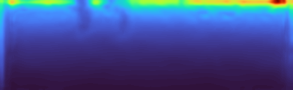

# MonoGeoFlightLog — measured results

Generated by `monogeo report` (package version 0.1.0). Every value below is read from a JSON file in this directory; nothing is typed by hand. Regenerate with `bash scripts/reproduce.sh`.

All numbers in this report were produced on the **synthetic** renderer.

### Calibration
| param | true (px) | estimated (px) | abs error (px) | rel error (%) |
|---|---|---|---|---|
| fx | 532.569 | 529.535 | 3.035 | 0.570 |
| fy | 532.569 | 530.036 | 2.533 | 0.476 |
| cx | 319.500 | 317.892 | 1.608 | 0.503 |
| cy | 239.500 | 240.035 | 0.535 | 0.223 |

| coeff | true | estimated | abs error |
|---|---|---|---|
| k1 | -0.12000 | -0.12719 | 0.00719 |
| k2 | 0.03000 | 0.08060 | 0.05060 |
| p1 | 0.00120 | 9.97021e-04 | 2.02979e-04 |
| p2 | -8.00000e-04 | -9.81472e-04 | 1.81472e-04 |
| k3 | 0 | -0.09873 | 0.09873 |

- RMS reprojection error: **0.3498 px** over 16/20 detected views
- distortion *field* displacement vs truth: mean 0.1494 px, max 2.6383 px
- checkerboard: [6, 7] inner corners, 0.040 m squares, images [640, 480] (w,h)

> k1/k2 are strongly correlated for a small planar target near the image centre; the residual *field* displacement is the honest measure of whether distortion was recovered.

### Classical two-view baseline
Evaluated on 12/12 frame pairs of the `forward` sequence at [128, 416] (h,w), frame gap 2. `matches`/`inliers` are medians over pairs.

| quantity | value |
|---|---|
| matches (median) | 62.0 |
| inliers (median) | 50.0 |
| inlier ratio (median) | 0.8150 |
| median reprojection error (px) | 0.1611 |
| RMS reprojection error (px) | 0.2710 |
| rotation error (deg) | 0.2487 |
| translation angular error (deg) | 2.8133 |
| recovered scale factor | 3.2611 |
| true baseline (m) | 3.2833 |
| runtime (ms/pair) | 9.69 |

Same pipeline with a **one-frame** baseline (the gap the learned models are trained on), for comparison:

| quantity | gap 1 |
|---|---|
| matches (median) | 72.5 |
| inlier ratio (median) | 0.7917 |
| median reprojection error (px) | 0.1319 |
| rotation error (deg) | 0.2377 |
| translation angular error (deg) | 3.7898 |
| recovered scale factor | 1.7306 |
| true baseline (m) | 1.6423 |

### Depth accuracy per method
Held-out frames [85, 118] of `forward`, 34 frames at [128, 416] (h,w), depth range [1.0, 120.0] m, gap 1. All metrics are medians over pairs; `delta<1.25` values are fractions (higher is better), the rest are errors (lower is better).

| method | AbsRel (raw) | SqRel (scaled) | RMSE (scaled) | RMSE-log (scaled) | d<1.25 (scaled) | AbsRel (scaled) | d<1.25 (raw) |
|---|---|---|---|---|---|---|---|
| `classical_two_view` | 0.407 | 1.088 | 7.33 | 0.165 | 0.861 | 0.094 | 0 |
| `self_supervised_monodepth` | 0.967 | 3.110 | 14.79 | 0.159 | 0.896 | 0.101 | 0 |
| `pointmap` | 0.975 | 0.252 | 3.44 | 0.061 | 0.988 | 0.031 | 0 |

*raw* = the network/triangulation output as-is (up to an unknown scale); *scaled* = after a single per-pair median scale factor. These are the standard Eigen et al. metrics.

### Pose accuracy per method
Per-pair errors are rotation (deg) and translation *direction* (deg). ATE and RPE are computed over the trajectory each method composes from its own per-pair transforms, after a 7-DoF Umeyama alignment of the camera centres (a monocular trajectory has no observable scale or global frame).

| method | rotation (deg) | translation dir (deg) | ATE RMSE (m) | RPE trans (m/frame) | RPE rot (deg/frame) |
|---|---|---|---|---|---|
| `classical_two_view` | 0.276 | 4.901 | 2.084 | 1.7632 | 2.295 |
| `self_supervised_monodepth` | 0.084 | 167.117 | 44.398 | 3.2125 | 0.082 |
| `pointmap` | 0.589 | 23.316 | 4.875 | 0.8833 | 0.666 |

### Scale analysis
Monocular geometry is recovered only up to scale. `scale_factor` is the per-frame median ratio gt/pred; `drift` is the std/mean of that factor across frames. `with_umeyama` additionally allows a 7-DoF similarity, which a depth-only method cannot exploit but a pointmap method can.

| method | scale factor | drift (std/mean) | AbsRel (none) | AbsRel (median) | AbsRel (umeyama) | d<1.25 (none) | d<1.25 (median) |
|---|---|---|---|---|---|---|---|
| `classical_two_view` | 1.654 | 0.642 | 0.407 | 0.097 | 0.097 | 0 | 0.873 |
| `self_supervised_monodepth` | 32.705 | 0.043 | 0.968 | 0.101 | 0.094 | 0 | 0.896 |
| `pointmap` | 41.065 | 0.050 | 0.975 | 0.032 | 0.031 | 0 | 0.987 |
| `classical_two_view_gap2` | 3.206 | 0.486 | 0.689 | 0.076 | 0.065 | 0 | 0.927 |

### Estimated vs calibrated focal length

| method | focal used (px) | focal estimated (px) | abs error (px) | rel error (%) |
|---|---|---|---|---|
| `classical_two_view` | 346.17 | n/a | n/a | n/a |
| `self_supervised_monodepth` | 346.17 | n/a | n/a | n/a |
| `pointmap` | 346.17 | 343.05 | 3.12 | 0.90 |
| `classical_two_view_gap2` | 346.17 | n/a | n/a | n/a |

The classical and self-supervised methods *consume* the calibrated focal length; only the pointmap model estimates it, from the pointmap geometry alone.

### Stress tests
Degradation of median-scaled AbsRel (%) relative to the clean held-out evaluation. **Positive always means worse.**

| method | motion_blur_sev1 | motion_blur_sev2 | motion_blur_sev3 | low_texture_sev1 | low_texture_sev2 | low_texture_sev3 | low_light_sev1 | low_light_sev2 | low_light_sev3 | jpeg_artifacts_sev1 | jpeg_artifacts_sev2 | jpeg_artifacts_sev3 |
|---|---|---|---|---|---|---|---|---|---|---|---|---|
| `classical_two_view` | 55.2 | 14.4 | 69.1 | 12.0 | 83.4 | 163.2 | 241.5 | n/a | n/a | 89.7 | 181.0 | 167.7 |
| `self_supervised_monodepth` | -7.7 | -21.1 | -33.8 | -28.6 | -64.5 | -60.8 | -33.2 | -46.3 | -36.6 | -6.5 | -5.6 | -14.9 |
| `pointmap` | 4.8 | 28.2 | 51.9 | 25.0 | 70.0 | 100.7 | 233.0 | 877.7 | 1321.5 | 5.5 | 15.4 | 33.6 |

Domain shift (no image corruption, just a different flight regime):

| method | altitude_descent | viewpoint_orbit |
|---|---|---|
| `classical_two_view` | 44.5 | 76.8 |
| `self_supervised_monodepth` | -15.5 | 199.6 |
| `pointmap` | 58.3 | 642.5 |

Absolute values per corruption and severity:

| variant | method | AbsRel (scaled) | d<1.25 (scaled) | rotation (deg) | AbsRel degradation (%) |
|---|---|---|---|---|---|
| motion_blur_sev1 | `classical_two_view` | 0.144 | 0.851 | 0.37 | 55.2 |
| motion_blur_sev1 | `self_supervised_monodepth` | 0.094 | 0.902 | 0.09 | -7.7 |
| motion_blur_sev1 | `pointmap` | 0.033 | 0.985 | 0.49 | 4.8 |
| motion_blur_sev2 | `classical_two_view` | 0.106 | 0.827 | 0.32 | 14.4 |
| motion_blur_sev2 | `self_supervised_monodepth` | 0.081 | 0.926 | 0.09 | -21.1 |
| motion_blur_sev2 | `pointmap` | 0.040 | 0.977 | 0.58 | 28.2 |
| motion_blur_sev3 | `classical_two_view` | 0.157 | 0.728 | 0.48 | 69.1 |
| motion_blur_sev3 | `self_supervised_monodepth` | 0.068 | 0.944 | 0.10 | -33.8 |
| motion_blur_sev3 | `pointmap` | 0.047 | 0.962 | 0.86 | 51.9 |
| low_texture_sev1 | `classical_two_view` | 0.104 | 0.844 | 0.25 | 12.0 |
| low_texture_sev1 | `self_supervised_monodepth` | 0.073 | 0.930 | 0.10 | -28.6 |
| low_texture_sev1 | `pointmap` | 0.039 | 0.985 | 0.62 | 25.0 |
| low_texture_sev2 | `classical_two_view` | 0.170 | 0.667 | 0.58 | 83.4 |
| low_texture_sev2 | `self_supervised_monodepth` | 0.036 | 0.984 | 0.10 | -64.5 |
| low_texture_sev2 | `pointmap` | 0.053 | 0.974 | 0.81 | 70.0 |
| low_texture_sev3 | `classical_two_view` | 0.244 | 0.511 | 0.98 | 163.2 |
| low_texture_sev3 | `self_supervised_monodepth` | 0.040 | 0.985 | 0.11 | -60.8 |
| low_texture_sev3 | `pointmap` | 0.063 | 0.953 | 0.98 | 100.7 |
| low_light_sev1 | `classical_two_view` | 0.316 | 0.470 | 0.94 | 241.5 |
| low_light_sev1 | `self_supervised_monodepth` | 0.068 | 0.969 | 0.11 | -33.2 |
| low_light_sev1 | `pointmap` | 0.104 | 0.925 | 3.53 | 233.0 |
| low_light_sev2 | `classical_two_view` | n/a | n/a | n/a | n/a |
| low_light_sev2 | `self_supervised_monodepth` | 0.055 | 0.945 | 0.13 | -46.3 |
| low_light_sev2 | `pointmap` | 0.305 | 0.396 | 3.66 | 877.7 |
| low_light_sev3 | `classical_two_view` | n/a | n/a | n/a | n/a |
| low_light_sev3 | `self_supervised_monodepth` | 0.065 | 0.920 | 0.15 | -36.6 |
| low_light_sev3 | `pointmap` | 0.443 | 0.267 | 5.96 | 1321.5 |
| jpeg_artifacts_sev1 | `classical_two_view` | 0.176 | 0.728 | 0.41 | 89.7 |
| jpeg_artifacts_sev1 | `self_supervised_monodepth` | 0.096 | 0.899 | 0.08 | -6.5 |
| jpeg_artifacts_sev1 | `pointmap` | 0.033 | 0.987 | 0.69 | 5.5 |
| jpeg_artifacts_sev2 | `classical_two_view` | 0.260 | 0.582 | 1.14 | 181.0 |
| jpeg_artifacts_sev2 | `self_supervised_monodepth` | 0.096 | 0.902 | 0.08 | -5.6 |
| jpeg_artifacts_sev2 | `pointmap` | 0.036 | 0.987 | 0.94 | 15.4 |
| jpeg_artifacts_sev3 | `classical_two_view` | 0.248 | 0.604 | 0.65 | 167.7 |
| jpeg_artifacts_sev3 | `self_supervised_monodepth` | 0.087 | 0.916 | 0.08 | -14.9 |
| jpeg_artifacts_sev3 | `pointmap` | 0.042 | 0.987 | 1.08 | 33.6 |

### C++ vs Python inference

| implementation | mean (ms) | p50 (ms) | p95 (ms) | notes |
|---|---|---|---|---|
| Python (PyTorch) | 28.701 | 28.645 | 29.207 | 50 runs, torch threads 4 |
| C++ (backend below) | 18.330 | 18.246 | 19.163 | 50 runs, backend cv::dnn (OpenCV 4.10.0), threads 4 |

- ONNX Runtime on the same graph: mean 34.399 ms, p50 34.067 ms, p95 35.023 ms

- speedup (Python mean / C++ mean): **1.566x**
- max abs output difference: **2.09808000e-05** (parity threshold 0.001000)
- mean abs output difference: 3.50700000e-07

### Training convergence

| model | schedule | loss (first epoch) | loss (last epoch) | reduction | wall time |
|---|---|---|---|---|---|
| self-supervised depth + pose | 12 epochs, batch 4, lr 3.000000e-04 | 0.2420 | 0.1137 | 53.0 % | 224 s |
| two-view pointmap | 15 epochs, batch 2, lr 3.000000e-04 | 0.5497 | -0.1757 | 79.3 % | 31 s |

The pointmap number is its confidence-weighted L1 regression term; the full DUSt3R objective also contains a `-alpha*log(conf)` term which is unbounded below and can go negative once the fit is good.

### Figures

